<!-- Profile README for github.com/SargunKaur15. Previous version: backup/README.2026-10-15.md -->


 

 


### Cybersecurity × AI

I'm a **B.Tech CSE student at GGSIPU Delhi** building at the intersection of **cybersecurity** and **artificial intelligence**. My projects follow a real SOC analyst's workflow — detect, triage, investigate, map to MITRE ATT&CK — and use **machine learning and LLMs** to make each step faster and smarter. I document exactly what each project does and doesn't do.

- **Security:** Blue Team / SOC operations, detection engineering, threat triage
- **AI:** ML-based intrusion detection, anomaly detection, LLM-assisted alert triage
- **Building:** [SOCGenie](https://github.com/SargunKaur15/SOCGenie), a SOC platform with an ML risk engine

**Goal:** build real-world AI and cybersecurity solutions, and grow into a skilled cybersecurity professional.

 




<table>
<tr>
<td width="50%" valign="top">

#### 

- **SOC workflow** — alert queue, investigation, incident status flow ([SOCGenie](https://github.com/SargunKaur15/SOCGenie))
- **Detection engineering** — 7-rule log detection engine
- **MITRE ATT&CK** — 14 techniques across 10 tactics, tied to alert evidence
- **IOC extraction** — IPs, URLs, file hashes from raw alerts ([CyberSentinel](https://github.com/SargunKaur15/AI-CyberSentinel-SOC-Dashboard))
- **Network analysis** — packet inspection with Scapy ([Packet Analyzer](https://github.com/SargunKaur15/Network-Packet-Analyzer))

</td>
<td width="50%" valign="top">

#### 

- **ML intrusion detection** — Random Forest on CSE-CIC-IDS2018 ([SOCGenie](https://github.com/SargunKaur15/SOCGenie))
- **Anomaly detection** — Isolation Forest for unseen behaviour
- **ML-assisted risk** — seven-factor risk engine with an ML factor
- **LLM alert triage** — structured severity + recommended actions ([CyberSentinel](https://github.com/SargunKaur15/AI-CyberSentinel-SOC-Dashboard))
- **Honest fallbacks** — deterministic rule-based mode when no model or API key is live

</td>
</tr>
</table>


Grouped from what my public repositories actually use. Nothing here is a proficiency rating.

<b>Cybersecurity</b>

 

<b>AI &amp; Machine Learning</b>

 

<b>Programming</b>

 

<b>Web &amp; Backend</b>

 

<b>Developer Tools</b>

 


<table>
<tr>
<td width="50%" valign="top">

<a href="https://github.com/SargunKaur15/SOCGenie"></a>

### [SOCGenie](https://github.com/SargunKaur15/SOCGenie)
 

Academic SOC platform prototype built around the real analyst workflow: log upload → **7-rule detection engine** → alert queue → investigation with attack-path view → **seven-factor risk score** → **MITRE ATT&CK map** (14 techniques, 10 tactics). A Random Forest + Isolation Forest model was trained and evaluated offline on CSE-CIC-IDS2018.

<code>React</code> <code>TypeScript</code> <code>Three.js</code> <code>Python</code> <code>FastAPI</code> <code>scikit-learn</code>

[Repository →](https://github.com/SargunKaur15/SOCGenie)

</td>
<td width="50%" valign="top">

<a href="https://github.com/SargunKaur15/AI-CyberSentinel-SOC-Dashboard"></a>

### [AI-CyberSentinel SOC Dashboard](https://github.com/SargunKaur15/AI-CyberSentinel-SOC-Dashboard)
 

Simulates Level-1 alert triage: paste a SIEM alert or raw log, extract **IOCs** (IPs, URLs, MD5/SHA-1/SHA-256) with regex, get a structured triage summary with a **severity rating**, and download an incident report. Falls back to deterministic rule-based triage when no API key is set.

<code>Python</code> <code>Streamlit</code> <code>OpenAI API (optional)</code>

[Repository →](https://github.com/SargunKaur15/AI-CyberSentinel-SOC-Dashboard)

</td>
</tr>
<tr>
<td width="50%" valign="top">

<a href="https://github.com/SargunKaur15/Network-Packet-Analyzer"></a>

### [Network Packet Analyzer](https://github.com/SargunKaur15/Network-Packet-Analyzer)

Scapy-based inspection tool that captures packets on an authorized interface and prints source/destination IP, protocol, TCP/UDP ports and a best-effort payload decode — the header-level visibility that IDS tools build on.

<code>Python</code> <code>Scapy</code>

[Repository →](https://github.com/SargunKaur15/Network-Packet-Analyzer)

</td>
<td width="50%" valign="top">

### Security Fundamentals

Small, clearly scoped Python tools from my security learning path:

- [**Password Strength Analyzer**](https://github.com/SargunKaur15/Password-Strength-Analyzer) — rule-based composition checker
- [**Image Encryption Tool**](https://github.com/SargunKaur15/Image-Encryption-Tool) — reversible per-pixel cipher (educational)
- [**Caesar Cipher Tool**](https://github.com/SargunKaur15/Caesar-Cipher-Tool) — classical cryptography

<code>Python</code> <code>Pillow</code>

</td>
</tr>
</table>

<table>
<tr>
<td valign="top">

**B.Tech, Computer Science & Engineering** 
Guru Gobind Singh Indraprastha University (GGSIPU), Delhi

</td>
</tr>
</table>

### Currently Exploring

- **Blue Team operations** — SIEM workflows, log analysis and incident response
- **Detection engineering** — writing and testing rules mapped to MITRE ATT&CK
- **Applied ML for security** — anomaly detection and ML-assisted risk scoring


Live cards from public services. If one doesn't load, the same numbers are on my <a href="https://github.com/SargunKaur15">GitHub profile</a>.

### Contribution Snake

<picture>
  <source media="(prefers-color-scheme: dark)" srcset="https://raw.githubusercontent.com/SargunKaur15/SargunKaur15/output/github-snake-dark.svg" />
  <source media="(prefers-color-scheme: light)" srcset="https://raw.githubusercontent.com/SargunKaur15/SargunKaur15/output/github-snake.svg" />
  
</picture>

Open to collaborating on security tooling, ML-for-security projects and student community initiatives.

 

